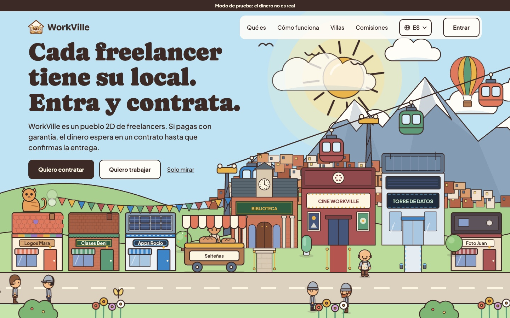
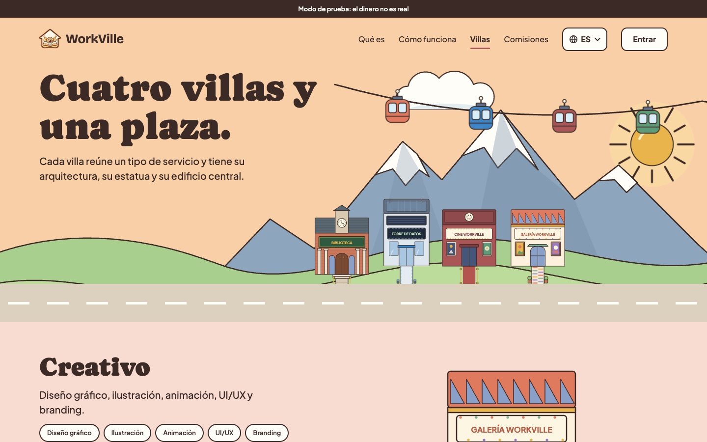
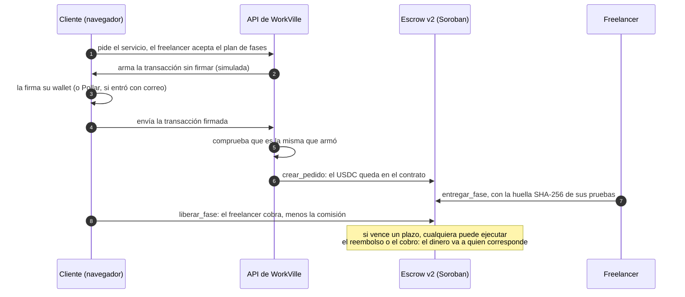
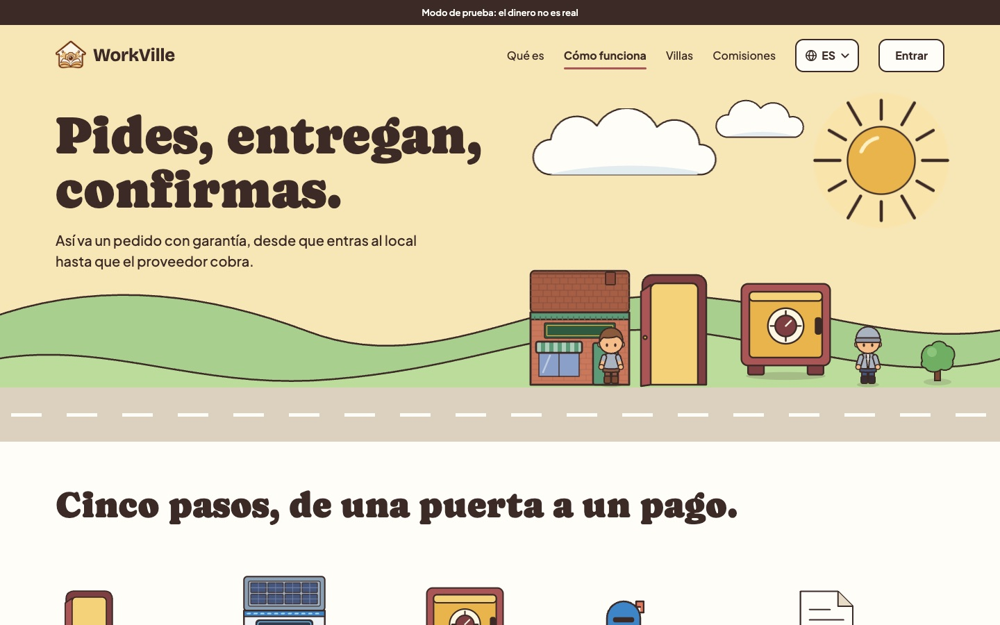
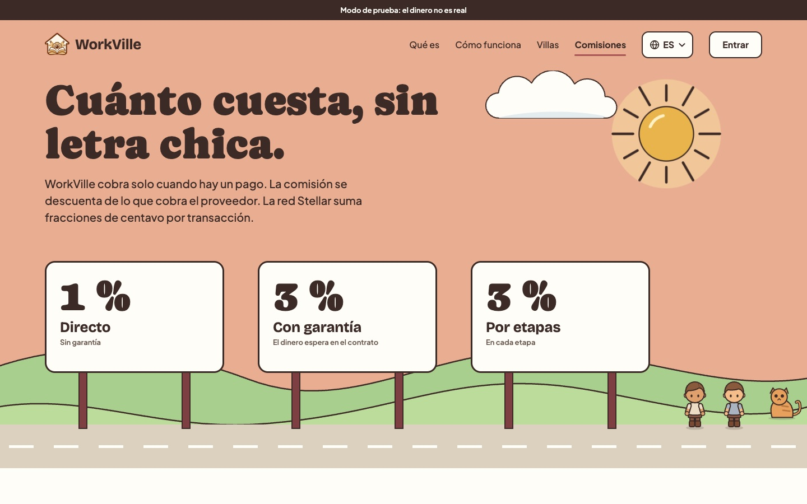

<div align="center">

# WorkVille 🏘️

### Un pueblo digital donde los freelancers de Bolivia y Latinoamérica ofrecen sus servicios y cobran de forma segura en USDC, con un contrato de garantía en Stellar.

[](https://myworkville.com)
[](https://stellar.expert/explorer/testnet/contract/CB42MFK5XZJBXWAHYXI6VCP3N75GQBNPAX77JK6W3ARIRK7N6YKHHUVO)
[](https://github.com/ozioziel/Workville/actions/workflows/ci.yml)
[](https://stellar.expert/explorer/testnet/contract/CBIELTK6YBZJU5UP2WWQEUCYKLPU6AUNZ2BQ4WWFEIE3USCIHMXQDAMA)
[](LICENSE)

**[Probarlo](https://myworkville.com)**, [Cómo funciona](#cómo-funciona), [Seguridad](#seguridad), [Por qué Stellar](#por-qué-stellar), [Qué está en vivo](#qué-está-en-vivo-hoy), [Próximos 30 días](#los-próximos-30-días), [English](README.md)



</div>

---

Contratar a alguien que no conoces, por internet, tiene un problema de los dos lados. El cliente teme pagar y no recibir nada. El freelancer teme entregar y no cobrar. Las plataformas internacionales lo resuelven cobrando comisiones altas y reteniendo el dinero durante días, y cobrar desde otro país sigue siendo caro. Lo que queda es pagar «a confianza» por transferencia o QR, o pedir un adelanto que el cliente no quiere dar.

**WorkVille pone el dinero en un contrato, no en manos de nadie.** Recorres un pueblo en 2D donde cada freelancer tiene su local. Entras, ves sus servicios, hablas con él y lo contratas ahí mismo. Pagas en USDC a un contrato de garantía en Soroban que libera el dinero por fases, a medida que se entrega el trabajo. Si el freelancer no entrega a tiempo, el dinero vuelve. Si el cliente no responde, el freelancer cobra igual. Si hay un desacuerdo, decide un árbitro.

Nadie, ni siquiera el equipo de WorkVille, puede llevarse el dinero de un pedido. Y para usarlo no hace falta saber de cripto: se entra con el correo.

Nuestro primer mercado es Bolivia, donde está el equipo y donde recibir y guardar dólares es especialmente difícil. El producto está pensado para trabajo entre países de toda la región.

## Cómo se usa

Un interruptor arriba al centro cambia el **modo de la villa**:

- **«Quiero contratar»:** las casas son los locales de los freelancers. Entras, ves sus servicios y su portafolio colgado en la pared, y pides.
- **«Quiero trabajar»:** las mismas villas muestran un cartel por cada **«Se busca»**, lo que alguien necesita. Entras y mandas tu propuesta.

Hay **cuatro villas** (Creativo, Tech, Audiovisual y Academy), cada una con su arquitectura, y una **Plaza principal** con un edificio por cada persona que tiene locales. Cada persona arma su personaje, y cada freelancer decora su casa por fuera y por dentro.

<div align="center">

</div>

## Cómo funciona



1. **Se acuerda el plan.** El freelancer acepta el pedido con su precio y, si es por etapas, un plan de 2 a 5 fases con monto y fecha límite cada una.
2. **Se paga al contrato.** La API arma la transacción y la firma la wallet de la persona, en el navegador. La API solo la envía si es idéntica a la que armó, y después vuelve a leer el pedido en el contrato: **el contrato es la fuente de verdad del dinero**.
3. **Se entrega y se libera fase por fase.** El freelancer sube sus pruebas y el contrato guarda su huella. El cliente libera la fase o pide cambios (hasta dos por fase).
4. **Los plazos se cumplen solos.** Si el freelancer no entrega a tiempo, el cliente recupera el dinero. Si el cliente no revisa a tiempo, el freelancer cobra. Una llave de mantenimiento ejecuta esos vencimientos, y nunca puede mandar el dinero a otro lado.
5. **Las disputas tienen árbitro.** Una fase en disputa se congela. El árbitro decide a favor del cliente, del freelancer o mitad y mitad. Si no decide en 14 días, se reparte 50/50.

**Tres formas de pagar:**

| Forma | Cómo funciona | Comisión |
|---|---|---:|
| Directo | El pago va al freelancer en la misma transacción. Para clientes de confianza | 1 % |
| Con garantía | El dinero espera en el contrato hasta que confirmas la entrega | 3 % |
| Por etapas | Igual, con 2 a 5 fases que se entregan y liberan una por una | 3 % por fase |

<div align="center">

</div>

## Por qué Stellar

- **USDC de verdad, en segundos y por centavos.** Un pago con garantía de USD 20 tiene sentido porque la comisión de red es una fracción de centavo, no un porcentaje.
- **Soroban para la garantía.** El contrato retiene el dinero y solo puede soltarlo según sus reglas: ni el cliente, ni el freelancer, ni el equipo pueden saltárselas.
- **Multifirma nativa.** El admin del contrato es una cuenta 2 de 3 y el árbitro, otra cuenta distinta 1 de 2. Son cuentas de Stellar comunes, sin contratos extra.
- **Sin cripto a la vista.** Con Pollar, una persona entra con su correo y recibe una wallet. Pollar le patrocina la cuenta y la trustline de USDC, así que no necesita XLM para empezar.
- **Verificable por cualquiera.** Cada paso de un pedido deja su transacción en la red, y el código desplegado se puede comparar con el del repositorio (SEP-55).

## Qué está en vivo hoy

Todo en **testnet**: aparece la franja «Modo de prueba: el dinero no es real».

| Parte | Estado | Evidencia |
|---|---|---|
| Contrato **escrow v2** | Desplegado en testnet | [`CB42MFK5…HHUVO`](https://stellar.expert/explorer/testnet/contract/CB42MFK5XZJBXWAHYXI6VCP3N75GQBNPAX77JK6W3ARIRK7N6YKHHUVO), 28 pruebas (incluida una de propiedades y la de actualización con el `.wasm` real), Release verificado `contratos-2` |
| Pagos directos, con garantía y por etapas | En vivo | Plan de fases, pruebas por fase, cambios, disputas y vencimientos |
| Admin y árbitro multifirma | En vivo | [Admin 2 de 3](https://stellar.expert/explorer/testnet/account/GD74KD7J7MZIB6R4O4NZC3BEMAEGAB2UOMZKYSCVHOPFBXPFKFINNNTU) y [árbitro 1 de 2](https://stellar.expert/explorer/testnet/account/GBGNHOJB22DVGVJBG47D7NDQVQPSHARIDWYL53R3XTA3GB3TOSBEZDBB), con su [guía](docs/multifirma.md) |
| Entrar con correo (Pollar) | En vivo | Wallet embebida; cuenta y trustline de USDC patrocinadas por Pollar. Google está listo pero apagado |
| Entrar con wallet | En vivo | Freighter y otras con Stellar Wallets Kit, también por QR (WalletConnect); firma SEP-53 |
| Villas 2D, «Se busca», Plaza, portafolio y CV | En vivo | [myworkville.com](https://myworkville.com) |
| Confianza | En vivo | KYC (Didit, en sandbox) con insignia ✔, reportar y bloquear, avisos por correo y en el navegador |
| Recarga con el QR del banco y retiro al banco | **Simulados** | QR con el formato real del QR Simple, marcado SIMULADO; USDC real de testnet desde una caja. La rampa con Pollar está programada para Bolivia, Brasil (Pix) y Argentina ([qué está simulado](docs/simulaciones.md)) |
| Calidad | Pruebas en el CI | Contratos v1 y v2, 78 casos de punta a punta en la API contra Supabase local, y pruebas de la web y del código compartido |

**Reconocimientos.** WorkVille obtuvo el **primer lugar en el Demo Day de Stellar Élite Bolivia** (10 de octubre de 2026), entre 46 graduados del programa, y se presentó en la llamada de la comunidad BAF × Stellar (3 de noviembre de 2026).

<div align="center">

</div>

## Seguridad

> **El dinero de un pedido solo puede salir del contrato hacia el cliente, el freelancer o la tesorería, y siempre según las reglas del contrato.** Lo que sigue abierto no es el contrato, son las personas que lo administran: por eso todo eso es público y se puede vigilar.

**Lo que está cerrado**

| Riesgo | Por qué no puede pasar |
|---|---|
| Que el equipo se lleve el dinero de un pedido | El contrato no tiene ninguna función para eso; el admin no puede mover fondos de pedidos |
| Cobrar sin entregar o sin que el cliente libere | Solo se cobra cuando el cliente libera la fase o vence su plazo de revisión |
| Que cambien la comisión de un pedido ya pagado | Cada pedido conserva la comisión y los plazos con que se creó |
| Que el admin resuelva disputas | Solo el árbitro resuelve, ni siquiera el admin (probado) |
| Cambiar el código de un día para otro | Una actualización exige 7 días de aviso, fijos en el contrato |
| Que el servidor firme por los usuarios | El servidor nunca firma pagos: arma la transacción, la wallet la firma y la API comprueba que sea la misma |
| Un hash falso o de otra transacción | Cada pago se verifica leyendo la red; un hash no se acepta dos veces |

**Lo que sigue abierto, y qué hay contra eso**

| Riesgo | Qué hay |
|---|---|
| El admin cambia el árbitro o la tesorería | Admin y árbitro son multifirmas con firmantes distintos, y cada cambio emite `ConfigActualizada`, que la app convierte en un aviso |
| Una actualización maliciosa después de los 7 días | El aviso queda en la red (`ActualizacionPropuesta`); en el sprint se publica en una página de transparencia |
| El contrato no está auditado | Corre solo en testnet. La auditoría externa es requisito antes de mainnet ([documento para el auditor](docs/contrato-v2.md)) |

El análisis completo, con los riesgos conocidos y cómo comprobar el código desplegado, está en [docs/contrato-v2.md](docs/contrato-v2.md). En mainnet, la API no arranca si queda algo de prueba en la configuración (`npm run mainnet:revisar`).

**Privacidad.** El KYC guarda solo una huella HMAC del documento. Pedidos, chat y disputas solo los ven sus participantes y el árbitro, por RLS. La web nunca escribe directo en la base: todo pasa por la API.

## Cómo se compara

| | Plataformas internacionales de freelance | Transferencia o QR del banco | [Trustless Work](https://docs.trustlesswork.com) | WorkVille |
|---|---|---|---|---|
| Qué es | Un mercado con pago retenido por la empresa | Un pago directo | Escrow como servicio en Soroban, para que otras apps lo integren | Un mercado con escrow propio en Soroban |
| Quién tiene el dinero mientras se trabaja | La plataforma | El freelancer, desde el primer momento | Un contrato | Un contrato |
| Quién puede verificarlo | Nadie de afuera | Nadie | Cualquiera, en la red | Cualquiera, en la red |
| Pensado para | Cualquier país, con comisiones altas | Clientes de confianza | Desarrolladores de otras apps | Freelancers y clientes, sin saber de cripto |

Trustless Work es una buena infraestructura de escrow en Stellar para quien quiere integrarla en su app. WorkVille es el producto final para el usuario: la villa, el pedido, el plan de fases, el árbitro y la reputación, sobre un contrato propio.

## Los próximos 30 días

Propuesta de sprint para los Instawards LATAM (desde el 1 de diciembre de 2026), con una prueba que cualquiera puede revisar desde afuera:

| Entregable | Listo cuando |
|---|---|
| **Pagar sin XLM** para quien entra con correo, con las comisiones patrocinadas por Pollar (fee-bump) | 5 cuentas nuevas completan un pedido con garantía sin XLM, y en stellar.expert cada transacción es un fee-bump que no pagó la persona |
| **Reputación verificable en Stellar**: un contrato `credenciales`, sin fondos, que registra cada trabajo terminado con sus clientes distintos | El contrato está desplegado con su Release verificado, 5 pedidos terminados tienen su credencial, y la placa de la casa y `/verificar` coinciden con la red |
| **Transparencia y gobernanza**: una página pública con el USDC que guarda el contrato y quién lo controla | `/transparencia` abre sin sesión y el USDC que muestra coincide con el saldo del contrato en stellar.expert |

Después: mainnet con la rampa de Pollar (primero Bolivia y después Brasil y Argentina), cuando el contrato pase una auditoría externa.

## Correrlo en tu PC

Necesitas **Node 22** o superior y **Docker Desktop** abierto (el setup levanta Supabase local en Docker). Para los contratos: **Rust** con el target `wasm32v1-none` (`rustup target add wasm32v1-none`) y, para compilarlos a `.wasm`, la [Stellar CLI](https://developers.stellar.org/docs/tools/cli) 25.2 o superior.

```bash
npm install
npm run hooks     # una vez por clon: el commit se rechaza si atribuye autoría a una IA
npm run setup     # Supabase local, .env, migraciones, wallets de ejemplo y datos
npm run dev       # API en :3000 y web en http://localhost:5173
```

**Para entrar:** con tu correo (si `POLLAR_API_KEY` está configurada), con Freighter u otra wallet en testnet (también por QR) o, en desarrollo, con *«entrar con una llave de prueba»* y una llave de `.seed-keys.json`. Sin las llaves de los servicios externos (Didit, Mux, Pollar, Resend, VAPID, WalletConnect) la app funciona igual y oculta esas funciones.

**Para probar pagos** hace falta un contrato: el `.env` local trae `ESCROW_V2_CONTRACT_ID` vacío. Despliega el tuyo en testnet siguiendo la [guía de Stellar Lab](docs/guia-stellar-lab.md#contrato-v2) y copia sus datos (contrato, tesorería, árbitro, comisiones y plazos) al `.env`; tienen que coincidir con los del constructor.

| Comando | Qué hace |
|---|---|
| `npm test` | Pruebas de `shared`, de la API (contra Supabase local) y de la web |
| `cd contracts && cargo test` | Pruebas de los contratos |
| `npm run contract:build` | Compila los contratos a `contracts/dist/*.wasm` e imprime su hash |
| `npm run db:reset` | Borra la base local y la vuelve a crear con los datos de ejemplo |
| `npm run mainnet:revisar` | Revisa el `.env` como si fuera mainnet y dice qué falta |

Para desplegar: [Supabase](docs/guia-supabase.md), [contratos en Stellar Lab](docs/guia-stellar-lab.md) y [VPS](docs/despliegue-vps.md).

## Repositorio

```
apps/web/            React 19 + Vite + Phaser 3: las villas 2D, los paneles y el arte en SVG
apps/api/            NestJS 11 + Prisma 7: pedidos, transacciones, sincronización con la red, KYC
packages/shared/     Estados del pedido, reglas (comisiones, plazos, límites), textos del contrato
contracts/           Rust + Soroban: escrow v1, escrow v2 y el token de prueba; .wasm en dist/
deploy/              Docker Compose, Caddy y scripts del VPS
docs/                Arquitectura, contrato, multifirmas, simulaciones, mainnet y guías
```

Documentación: [descripción](docs/descripcion.md), [arquitectura](docs/arquitectura.md), [contrato v2 (para el auditor)](docs/contrato-v2.md), [cuentas y contratos desplegados](docs/cuentas-y-contratos.md), [multifirmas](docs/multifirma.md), [qué está simulado](docs/simulaciones.md), [pasar a mainnet](docs/mainnet.md) y [roadmap](docs/roadmap.md).

## Equipo

WorkVille nació en Bolivia. Lo construyen **Oziel Rodman Ramos Torrez** ([@ozioziel](https://github.com/ozioziel)), fundador y diseñador UX/UI; **Luis Daniel Rojas Caceres** ([@daniel69zz](https://github.com/daniel69zz)), toda la parte técnica: contratos en Soroban, integración con Stellar y Pollar, API y backend, y despliegue; y **Rafael Einar Chalco Huanca** ([@Einar-KAILOOP](https://github.com/Einar-KAILOOP)), con aportes de [@Holorololo](https://github.com/Holorololo). Somos parte del capítulo de Embajadores de Stellar Bolivia.

## Contribuir

Los issues y pull requests son bienvenidos. **Si encuentras una forma de mover dinero de un pedido fuera de las reglas del contrato, abre un issue**: es el reporte más útil que hay. Todo el repo está en español, también los commits (`feat(web): …`, `fix(api): …`).

## Licencia

Código abierto bajo la licencia [MIT](LICENSE).

**Créditos:** fuente [Plus Jakarta Sans](https://fonts.google.com/specimen/Plus+Jakarta+Sans) (SIL Open Font License). El arte de las villas, las casas y los personajes está dibujado en vectores para WorkVille (`apps/web/src/arte/`); los personajes se inspiran en *Tiny Dungeon* de [Kenney](https://kenney.nl). Los gráficos anteriores de Kenney (*Tiny Town* y *Tiny Dungeon*, licencia CC0) ya no se usan, pero se conservan en `apps/web/public/assets/kenney/`.
