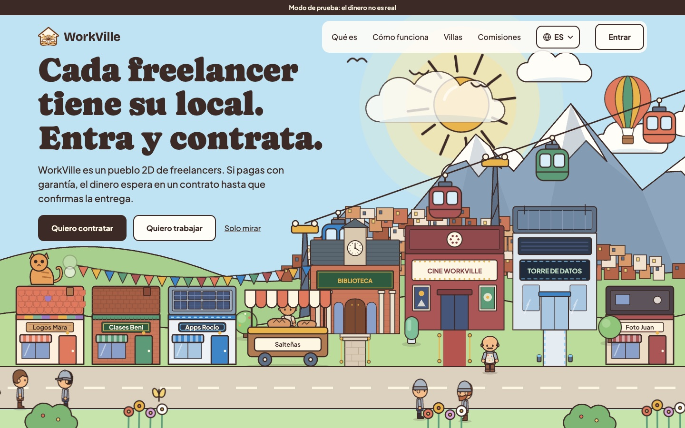
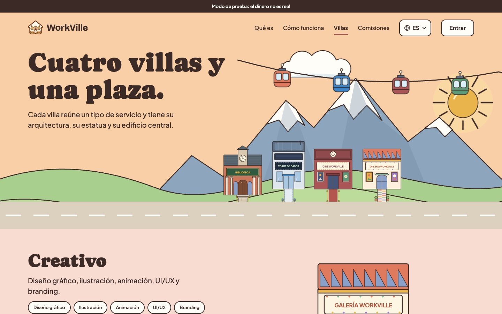
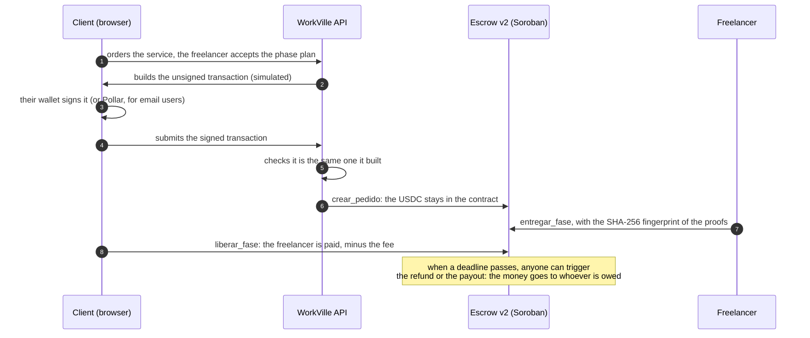
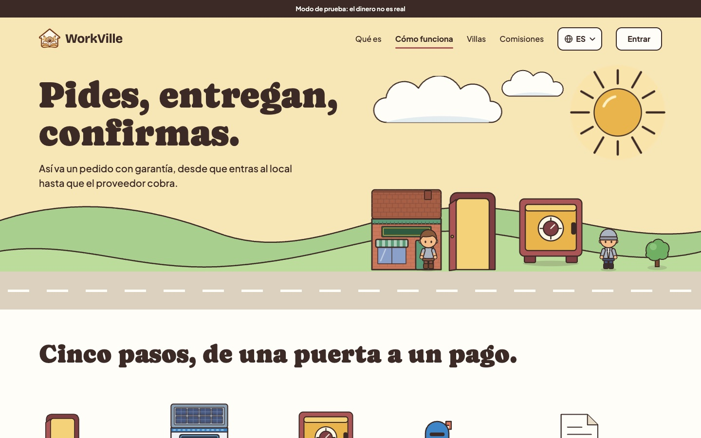
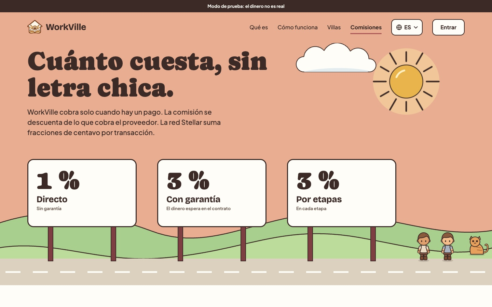

<div align="center">

# WorkVille 🏘️

### A digital village where freelancers in Bolivia and Latin America offer their services and get paid safely in USDC, through an escrow contract on Stellar.

[](https://myworkville.com)
[](https://stellar.expert/explorer/testnet/contract/CB42MFK5XZJBXWAHYXI6VCP3N75GQBNPAX77JK6W3ARIRK7N6YKHHUVO)
[](https://github.com/ozioziel/Workville/actions/workflows/ci.yml)
[](https://stellar.expert/explorer/testnet/contract/CBIELTK6YBZJU5UP2WWQEUCYKLPU6AUNZ2BQ4WWFEIE3USCIHMXQDAMA)
[](LICENSE)

**[Try it](https://myworkville.com)**, [How it works](#how-it-works), [Security](#security), [Why Stellar](#why-stellar), [What is live](#what-is-live-today), [Next 30 days](#the-next-30-days), [Español](README-ES.md)



</div>

---

Hiring someone you don't know, online, has a problem on both sides. The client fears paying and getting nothing. The freelancer fears delivering and never getting paid. International platforms solve it by charging high fees and holding the money for days, and getting paid from another country is still expensive. What's left is paying "on trust" by bank transfer or QR, or asking for an advance the client doesn't want to give.

**WorkVille puts the money in a contract, not in anyone's hands.** You walk through a 2D village where every freelancer has a shop. You go in, see their services, chat, and hire them right there. You pay in USDC into a Soroban escrow contract that releases the money phase by phase as the work is delivered. If the freelancer misses the deadline, the money goes back. If the client never responds, the freelancer still gets paid. If they disagree, an arbiter decides.

Nobody, not even the WorkVille team, can take the money of an order. And using it takes no crypto knowledge: you sign in with your email.

Our first market is Bolivia, where the team is and where receiving and holding dollars is especially hard. The product is built for cross-border work across the region.

## How people use it

A switch at the top center changes the **village mode**:

- **"I want to hire":** the houses are the freelancers' shops. Go in, see their services and the portfolio hanging on the wall, and order.
- **"I want to work":** the same villages show a sign for every **"Wanted"** post, something someone needs. Go in and send your proposal.

There are **four villages** (Creative, Tech, Audiovisual and Academy), each with its own architecture, and a **Main Plaza** with one building per person who has shops. Everyone builds their own character, and every freelancer decorates their house inside and out.

<div align="center">

</div>

## How it works



1. **The plan is agreed.** The freelancer accepts the order with a price and, for phased work, a plan of 2 to 5 phases, each with an amount and a deadline.
2. **The contract is paid.** The API builds the transaction and the person's wallet signs it in the browser. The API only submits it if it is identical to the one it built, then re-reads the order from the contract: **the contract is the source of truth for money**.
3. **Phase by phase.** The freelancer uploads proofs and the contract stores their fingerprint. The client releases the phase or asks for changes (up to two per phase).
4. **Deadlines enforce themselves.** If the freelancer misses the deadline, the client gets the money back. If the client doesn't review in time, the freelancer is paid. A maintenance key triggers those timeouts, and it can never send the money anywhere else.
5. **Disputes have an arbiter.** A disputed phase is frozen. The arbiter decides for the client, the freelancer or half and half. If there is no decision within 14 days, it splits 50/50.

**Three ways to pay:**

| Method | How it works | Fee |
|---|---|---:|
| Direct | The payment reaches the freelancer in the same transaction. For trusted clients | 1% |
| Escrow | The money waits in the contract until the client confirms delivery | 3% |
| Phased | Same, with 2 to 5 phases delivered and released one by one | 3% per phase |

<div align="center">

</div>

## Why Stellar

- **Real USDC, in seconds, for cents.** A USD 20 escrow payment makes sense because the network fee is a fraction of a cent, not a percentage.
- **Soroban for the escrow.** The contract holds the money and can only release it by its rules: not the client, the freelancer or the team can skip them.
- **Native multisig.** The contract admin is a 2-of-3 account and the arbiter a separate 1-of-2 account. Plain Stellar accounts, no extra contracts.
- **No crypto in sight.** With Pollar, a person signs in with an email and gets a wallet. Pollar sponsors the account and the USDC trustline, so no XLM is needed to start.
- **Verifiable by anyone.** Every step of an order leaves its transaction on the network, and the deployed code can be matched with the repository (SEP-55).

## What is live today

All on **testnet**: the app shows a "Test mode: the money is not real" banner.

| Component | Status | Evidence |
|---|---|---|
| **Escrow v2** contract | Deployed on testnet | [`CB42MFK5…HHUVO`](https://stellar.expert/explorer/testnet/contract/CB42MFK5XZJBXWAHYXI6VCP3N75GQBNPAX77JK6W3ARIRK7N6YKHHUVO), 28 tests (including a property test and the upgrade test with the real `.wasm`), verified release `contratos-2` |
| Direct, escrow and phased payments | Live | Phase plans, per-phase proofs, change requests, disputes and timeouts |
| Multisig admin and arbiter | Live | [Admin 2-of-3](https://stellar.expert/explorer/testnet/account/GD74KD7J7MZIB6R4O4NZC3BEMAEGAB2UOMZKYSCVHOPFBXPFKFINNNTU) and [arbiter 1-of-2](https://stellar.expert/explorer/testnet/account/GBGNHOJB22DVGVJBG47D7NDQVQPSHARIDWYL53R3XTA3GB3TOSBEZDBB), with their [guide](docs/multifirma.md) |
| Email sign-in (Pollar) | Live | Embedded wallet; account and USDC trustline sponsored by Pollar. Google is ready but off |
| Wallet sign-in | Live | Freighter and others through Stellar Wallets Kit, also by QR (WalletConnect); SEP-53 signature |
| 2D villages, "Wanted" board, Plaza, portfolio and CV | Live | [myworkville.com](https://myworkville.com) |
| Trust | Live | KYC (Didit, sandbox) with a ✔ badge, report and block, email and browser notifications |
| Top-up with a bank QR and withdrawal to a bank | **Simulated** | A QR in the real QR Simple format, marked SIMULATED; real testnet USDC from a cash wallet. The Pollar ramp is coded for Bolivia, Brazil (Pix) and Argentina ([what is simulated](docs/simulaciones.md), in Spanish) |
| Quality | Tests in CI | Escrow v1 and v2 contracts, 78 end-to-end API cases against local Supabase, plus web and shared-code tests |

**Recognition.** WorkVille won **first place at the Stellar Élite Bolivia Demo Day** (October 10, 2026), among 46 program graduates, and was presented at the BAF × Stellar community call (November 3, 2026).

<div align="center">

</div>

## Security

> **An order's money can only leave the contract to the client, the freelancer or the treasury, and always by the contract's rules.** What stays open is not the contract but the people who administer it: that is why all of it is public and can be watched.

**What is closed**

| Risk | Why it can't happen |
|---|---|
| The team taking an order's money | The contract has no function for that; the admin cannot move order funds |
| Getting paid without delivering or without the client's release | Payment only happens when the client releases the phase or its review period expires |
| Changing the fee of an order already paid | Every order keeps the fee and deadlines it was created with |
| The admin resolving disputes | Only the arbiter resolves, not even the admin (tested) |
| Changing the code overnight | An upgrade requires 7 days of notice, fixed in the contract |
| The server signing for users | The server never signs payments: it builds the transaction, the wallet signs it, and the API checks it is the same |
| A fake hash or someone else's transaction | Every payment is verified by reading the network; a hash is never accepted twice |

**What stays open, and what stands against it**

| Risk | What there is |
|---|---|
| The admin changing the arbiter or the treasury | Admin and arbiter are multisig accounts with different signers, and every change emits `ConfigActualizada`, which the app turns into a notice |
| A malicious upgrade after the 7 days | The notice stays on chain (`ActualizacionPropuesta`); the sprint publishes it on a transparency page |
| The contract is not audited | It only runs on testnet. An external audit is required before mainnet ([auditor notes](docs/contrato-v2.md), in Spanish) |

The full analysis, with known risks and how to check the deployed code, is in [docs/contrato-v2.md](docs/contrato-v2.md). On mainnet, the API refuses to start if anything test-like remains in the configuration (`npm run mainnet:revisar`).

**Privacy.** KYC stores only an HMAC fingerprint of the document. Orders, chat and disputes are visible only to their participants and the arbiter, through RLS. The web never writes to the database directly: everything goes through the API.

## How it compares

| | International freelance platforms | Bank transfer or QR | [Trustless Work](https://docs.trustlesswork.com) | WorkVille |
|---|---|---|---|---|
| What it is | A marketplace where the company holds the payment | A direct payment | Escrow as a service on Soroban, for other apps to integrate | A marketplace with its own Soroban escrow |
| Who holds the money during the work | The platform | The freelancer, from the start | A contract | A contract |
| Who can verify it | Nobody outside | Nobody | Anyone, on chain | Anyone, on chain |
| Built for | Any country, with high fees | Trusted clients | Developers of other apps | Freelancers and clients who know nothing about crypto |

Trustless Work is good escrow infrastructure on Stellar for anyone who wants to integrate it into their app. WorkVille is the end-user product: the village, the order, the phase plan, the arbiter and the reputation, on its own contract.

## The next 30 days

Our Instawards LATAM sprint proposal (from December 1, 2026), each deliverable with a check anyone can run from outside:

| Deliverable | Done when |
|---|---|
| **Pay without XLM** for email users, with fees sponsored by Pollar (fee-bump) | 5 new accounts complete an escrow order without XLM, and on stellar.expert every transaction is a fee-bump the person did not pay |
| **Verifiable reputation on Stellar**: a fund-less `credenciales` contract that records every completed job with its distinct clients | The contract is deployed with a verified release, 5 completed orders have their credential, and the house plaque and `/verificar` match the chain |
| **Transparency and governance**: a public page showing the USDC the contract holds and who controls it | `/transparencia` opens without signing in and the USDC it shows matches the contract balance on stellar.expert |

After that: mainnet with Pollar's ramp (Bolivia first, then Brazil and Argentina), once the contract passes an external audit.

## Run it locally

Requires **Node 22+** and **Docker Desktop** running (setup starts a local Supabase in Docker). For the contracts: **Rust** with the `wasm32v1-none` target (`rustup target add wasm32v1-none`) and, to build them into `.wasm`, the [Stellar CLI](https://developers.stellar.org/docs/tools/cli) 25.2 or later.

```bash
npm install
npm run hooks     # once per clone: rejects commits that credit an AI as author
npm run setup     # local Supabase, .env, migrations, sample wallets and data
npm run dev       # API on :3000 and web on http://localhost:5173
```

**Signing in:** with your email (if `POLLAR_API_KEY` is set), with Freighter or another testnet wallet (also by QR) or, in development, with *"sign in with a test key"* and a key from `.seed-keys.json`. Without the external service keys (Didit, Mux, Pollar, Resend, VAPID, WalletConnect) the app still works and hides those features.

**To try payments** you need a contract: the local `.env` comes with `ESCROW_V2_CONTRACT_ID` empty. Deploy your own on testnet with the [Stellar Lab guide](docs/guia-stellar-lab.md#contrato-v2) (in Spanish) and copy its data (contract, treasury, arbiter, fees and deadlines) into `.env`; they must match the constructor.

| Command | What it does |
|---|---|
| `npm test` | Tests for `shared`, the API (against local Supabase) and the web |
| `cd contracts && cargo test` | Contract tests |
| `npm run contract:build` | Builds the contracts into `contracts/dist/*.wasm` and prints their hash |
| `npm run db:reset` | Wipes the local database and recreates it with sample data |
| `npm run mainnet:revisar` | Checks the `.env` as if it were mainnet and lists what is missing |

Deployment guides (in Spanish): [Supabase](docs/guia-supabase.md), [contracts in Stellar Lab](docs/guia-stellar-lab.md) and [VPS](docs/despliegue-vps.md).

## Repository

```
apps/web/            React 19 + Vite + Phaser 3: the 2D villages, the panels and the SVG art
apps/api/            NestJS 11 + Prisma 7: orders, transactions, network sync, KYC
packages/shared/     Order states, rules (fees, deadlines, limits), contract texts
contracts/           Rust + Soroban: escrow v1, escrow v2 and the test token; .wasm in dist/
deploy/              Docker Compose, Caddy and the VPS scripts
docs/                Architecture, contract, multisig, simulations, mainnet and guides
```

The repository, its code and its documentation are in Spanish: [description](docs/descripcion.md), [architecture](docs/arquitectura.md), [escrow v2 (for the auditor)](docs/contrato-v2.md), [deployed accounts and contracts](docs/cuentas-y-contratos.md), [multisig](docs/multifirma.md), [what is simulated](docs/simulaciones.md), [going to mainnet](docs/mainnet.md) and [roadmap](docs/roadmap.md).

## Team

WorkVille was born in Bolivia. It is built by **Oziel Rodman Ramos Torrez** ([@ozioziel](https://github.com/ozioziel)), founder and UX/UI designer; **Luis Daniel Rojas Caceres** ([@daniel69zz](https://github.com/daniel69zz)), all the technical work: Soroban contracts, the Stellar and Pollar integration, the API and backend, and deployment; and **Rafael Einar Chalco Huanca** ([@Einar-KAILOOP](https://github.com/Einar-KAILOOP)), with contributions from [@Holorololo](https://github.com/Holorololo). We are part of the Stellar Ambassadors Bolivia chapter.

## Contributing

Issues and pull requests are welcome. **If you find a way to move an order's money outside the contract's rules, open an issue**: it is the most useful report there is. The whole repository is in Spanish, commits included (`feat(web): …`, `fix(api): …`).

## License

Open source under the [MIT](LICENSE) license.

**Credits:** [Plus Jakarta Sans](https://fonts.google.com/specimen/Plus+Jakarta+Sans) font (SIL Open Font License). The art of the villages, houses and characters is drawn in vectors for WorkVille (`apps/web/src/arte/`); the characters are inspired by [Kenney](https://kenney.nl)'s *Tiny Dungeon*. The earlier Kenney graphics (*Tiny Town* and *Tiny Dungeon*, CC0) are no longer used but are kept in `apps/web/public/assets/kenney/`.
